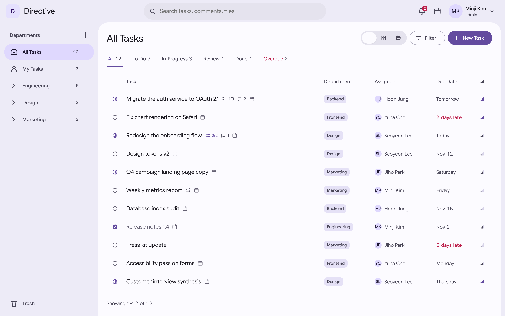
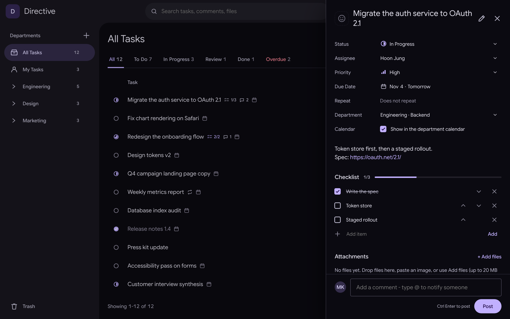
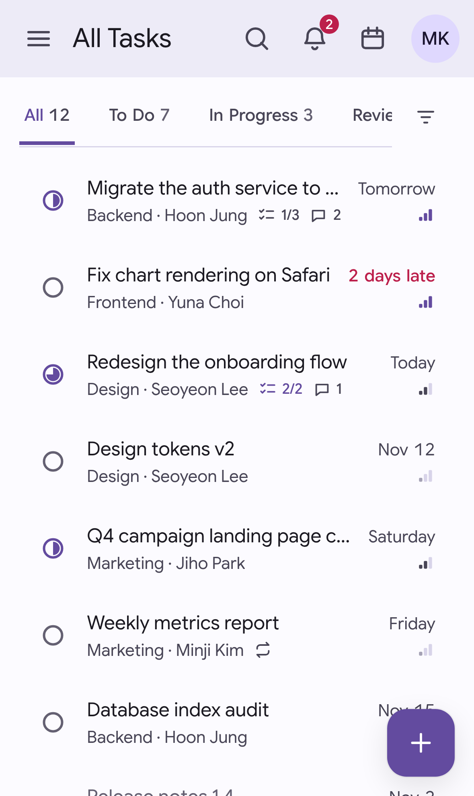

# Directive

**English** · [한국어](#한국어)

A self-hosted task board for a team split into departments. One small binary
holds the server, the web app and its database - copy it to a machine, run it,
and open a browser.

**[Try the demo](https://nveloper.github.io/Directive/)** - the real interface running on sample data in your
browser, with no server behind it. Nothing you do there is kept.



<p>
  
  
</p>

## Features

- **Departments and tasks** — a department tree in the sidebar, each with a
  colour of its choosing; tasks with status, priority, assignee and due date.
  Members change work in their own department; an administrator runs
  everything else.
- **Three views** — a list (sortable by its column headings), a board with a
  column per status (drag a card to change it), and a month calendar by due
  date. Status tabs and overdue work flagged in all of them.
- **Task details** — a side panel where status, assignee, priority, due date
  and department are changed in place; a description with links, a checklist,
  file attachments (images shown inline), an emoji or picture as the task's
  icon, and one timeline of comments (with `@mentions`) and changes.
- **Fast to drive** — `Ctrl/⌘ K` opens a command menu that jumps anywhere and
  searches tasks; `C` new task, `/` search, `J`/`K` move, `X` select,
  `1`/`2`/`3` switch views. Several tasks can be selected and changed or
  trashed at once.
- **Repeating tasks** — daily, weekly, monthly or yearly; finishing one rolls
  it on to the next date.
- **Notifications** — when a task is assigned to you, you are mentioned, your
  work is commented on, or a task of yours is due today or tomorrow. Desktop
  alerts are available over HTTPS.
- **Search, sort and filter** — search reaches descriptions, checklists,
  comments and file names and shows where it found a match; sort by due date,
  priority, update or title; filter by assignee, priority or calendar.
- **Trash** — deleted tasks can be restored for 10 days.
- **Calendars** — a subscribable `.ics` feed per department, and two-way
  CalDAV sync with Apple Reminders and other clients, using per-device app
  passwords.
- **Accounts** — the first account is the administrator; later sign-ups wait
  for approval. Everyone can change their password; an administrator can
  reset one.
- **Backups** — a daily backup at a time you choose, including attachment
  files, with downloads from the app.
- **Live and localised** — changes appear on every open screen without
  reloading. The interface follows the system language (Korean or English)
  and the light or dark setting, with an accent colour of your choice, and
  works on a phone.

## Requirements

- **To run:** nothing to install. The release binary is self-contained
  (Windows `directive.exe`, Linux x86-64 `directive-linux-amd64`) and uses a
  built-in SQLite database.
- **Server:** any machine that can run the binary; a few hundred MB of RAM is
  plenty for a small team. Disk use grows with attachments and backups.
- **Browser:** a current Chrome, Edge, Firefox or Safari.
- **Optional:** a reverse proxy with an HTTPS certificate (needed for desktop
  notifications and phone calendar sync).
- **To build:** Go 1.26 or later; no C compiler.

## Running it

### On Windows, for trying it out

From the repository folder:

```bash
./server/directive.exe -addr 0.0.0.0:8080 -db server/directive-dev.db
```

Open `http://localhost:8080`. Always pass `-db`: without it a new, empty
database is created in the current folder. `Ctrl+C` stops the server.

### On a Linux server

Copy `server/directive-linux-amd64` to the server; nothing else is needed.

```bash
chmod +x directive-linux-amd64
./directive-linux-amd64 -addr :8080 -db /srv/directive/directive.db -trusted-proxy 172.16.0.0/12
```

`attachments/` and `backups/` folders are created beside the database. The
first account registered becomes the administrator.

### Starting at boot (systemd)

`/etc/systemd/system/directive.service`:

```ini
[Unit]
Description=Directive
After=network.target

[Service]
ExecStart=/srv/directive/directive-linux-amd64 -addr :8080 -db /srv/directive/directive.db -trusted-proxy 172.16.0.0/12
WorkingDirectory=/srv/directive
Restart=always
User=directive

[Install]
WantedBy=multi-user.target
```

`User=` is the account the server runs as; it needs to own `/srv/directive`.

```bash
sudo systemctl daemon-reload
```

```bash
sudo systemctl enable --now directive
```

Logs: `journalctl -u directive -f`.

### Options

| Option | Meaning |
|---|---|
| `-addr` | Address and port to listen on (default `:8080`) |
| `-db` | Path to the database file |
| `-attachments-dir` | Folder for attachment files (default: `attachments` beside the database) |
| `-backup-dir` | Folder for automatic backups (default: `backups` beside the database) |
| `-trusted-proxy` | Reverse proxies whose forwarded headers are believed (default: this machine) |
| `-tls-cert`, `-tls-key` | Serve HTTPS directly, without a proxy |
| `-backup <path>` | Write one copy of the database and exit |
| `-reset-admin <username>` | Forgotten administrator password: print a temporary one and exit (stop the server first). The app asks for a new password at the next sign-in |

### HTTPS

Put it behind a reverse proxy such as Nginx Proxy Manager: add a Proxy Host
forwarding to port 8080, request a certificate with *Force SSL* on, and add
`client_max_body_size 25m;` under *Advanced* so 20 MB attachments get through.
Start Directive with `-trusted-proxy` set to the proxy's address: `172.16.0.0/12`
for NPM in Docker on the same machine, or the proxy machine's IP. Step-by-step
notes are in [server/README.md](server/README.md#https).

## Notes and cautions

- **Always pass `-db`** with an explicit path, or a new empty database is
  created in whatever folder you started from.
- **Register the administrator first.** The first account to sign up becomes
  the administrator, so do that before exposing the server to others.
- **Use HTTPS on anything public.** Passwords and sessions travel in clear text
  over plain HTTP. Set `-trusted-proxy` only to your own proxy's address.
- **Back up the attachments too.** They live outside the database, in
  `attachments/`. Scheduled backups include them; the command-line `-backup`
  copies only the database.
- **Limits:** 20 MB per attachment, 30 per task. Set `client_max_body_size`
  in the proxy accordingly.
- **Stop the server before restoring** a backup.
- Deleted tasks are removed for good after 10 days in the trash.

## Building

Go 1.26 or later (see `server/go.mod`), no C compiler needed:

```bash
cd server
go test ./...
go build -o directive.exe .                                     # Windows
GOOS=linux GOARCH=amd64 CGO_ENABLED=0 go build -o directive-linux-amd64 .
```

Everything else - calendars, CalDAV, backups and restores, attachment storage,
the API - is described in [server/README.md](server/README.md).

### The demo page

`demo/` turns the same frontend into a static page: `demo/mock-api.js` answers
the app's API calls from sample data in the browser. `demo/build.sh _site`
assembles it, and `.github/workflows/pages.yml` publishes it to GitHub Pages on
every push to `main` (turn Pages on once under *Settings → Pages → Source:
GitHub Actions*). File uploads, sign-out and a few administrator tools are
switched off there.

---

# 한국어

[English](#directive) · **한국어**

부서 단위로 일하는 팀을 위한 설치형 업무 관리 앱입니다. 서버, 웹 화면, DB가 작은
실행 파일 하나에 들어 있어서, 서버에 복사해 실행하고 브라우저로 열면 바로 씁니다.

**[데모 보기](https://nveloper.github.io/Directive/)** - 실제 화면을 서버 없이 브라우저 안의 샘플 데이터로 돌립니다.
데모에서 바꾼 내용은 저장되지 않습니다.

## 기능

- **부서와 작업**: 사이드바의 부서 트리(부서마다 색 지정 가능), 상태·우선순위·
  담당자·기한을 가진 작업. 구성원은 자기 부서의 작업을 바꾸고, 나머지 관리는
  관리자가 합니다.
- **세 가지 보기**: 목록(열 제목을 눌러 정렬), 상태별 보드(카드를 끌어 상태 변경),
  기한별 월간 캘린더. 어느 보기든 상태 탭이 있고 기한 지난 작업이 표시됩니다.
- **작업 상세**: 오른쪽 패널에서 상태·담당자·우선순위·기한·부서를 바로 바꿉니다.
  링크가 걸리는 설명, 체크리스트, 첨부파일(이미지는 바로 보임), 이모지나 사진
  아이콘, 그리고 코멘트(`@언급`)와 변경 이력을 합친 타임라인.
- **빠른 조작**: `Ctrl/⌘ K` 명령 메뉴로 어디든 이동하고 작업을 찾습니다. `C` 새 작업,
  `/` 검색, `J`/`K` 이동, `X` 선택, `1`/`2`/`3` 보기 전환. 여러 작업을 골라
  한꺼번에 바꾸거나 휴지통으로 옮길 수 있습니다.
- **반복 작업**: 매일, 매주, 매월, 매년. 끝내면 다음 날짜로 넘어갑니다.
- **알림**: 작업을 배정받거나, 언급되거나, 내 작업에 코멘트가 달리거나, 내 작업의
  기한이 오늘이나 내일일 때 알려 줍니다. HTTPS에서는 데스크톱 알림도 됩니다.
- **검색, 정렬, 필터**: 설명, 체크리스트, 코멘트, 파일 이름까지 찾고 어디서
  찾았는지 보여 줍니다. 기한순, 우선순위순, 최근 수정순, 제목순으로 정렬하고
  담당자, 우선순위, 캘린더 노출 여부로 거릅니다.
- **휴지통**: 지운 작업은 10일 동안 되살릴 수 있습니다.
- **캘린더**: 부서마다 구독할 수 있는 `.ics` 주소가 있고, Apple 미리 알림 등과
  CalDAV로 양방향 동기화합니다. 기기마다 앱 비밀번호를 따로 씁니다.
- **계정**: 처음 가입한 계정이 관리자가 되고, 이후 가입은 승인을 기다립니다.
  누구나 비밀번호를 바꿀 수 있고, 관리자는 초기화할 수 있습니다.
- **백업**: 정한 시각에 매일 백업하며 첨부파일도 함께 챙깁니다. 앱에서 내려받을 수
  있습니다.
- **실시간, 다국어**: 바뀐 내용이 새로고침 없이 모든 화면에 바로 반영됩니다. 화면은
  시스템 언어(한국어 또는 영어)와 밝은/어두운 모드를 따르고, 강조 색은 원하는
  대로 고릅니다. 휴대폰에서도 쓸 수 있습니다.

## 요구 사양

- **실행:** 따로 설치할 것이 없습니다. 배포 파일 하나(Windows `directive.exe`,
  Linux x86-64 `directive-linux-amd64`)에 모두 들어 있고, SQLite DB가 내장되어
  있습니다.
- **서버:** 실행 파일이 돌아가는 컴퓨터면 됩니다. 소규모 팀이라면 메모리 수백 MB로
  충분하고, 디스크는 첨부파일과 백업이 쌓이는 만큼 늘어납니다.
- **브라우저:** 최신 Chrome, Edge, Firefox, Safari.
- **선택:** HTTPS 인증서를 붙인 리버스 프록시 (데스크톱 알림과 휴대폰 캘린더
  동기화에 필요).
- **빌드:** Go 1.26 이상, C 컴파일러 불필요.

## 실행 방법

### Windows에서 테스트용으로

저장소 폴더에서 실행합니다.

```bash
./server/directive.exe -addr 0.0.0.0:8080 -db server/directive-dev.db
```

`http://localhost:8080`으로 엽니다. `-db`는 꼭 넣으세요. 빠뜨리면 현재 폴더에 새
빈 DB가 생깁니다. `Ctrl+C`로 종료합니다.

### Linux 서버에서

`server/directive-linux-amd64` 파일 하나만 서버로 복사하면 됩니다.

```bash
chmod +x directive-linux-amd64
./directive-linux-amd64 -addr :8080 -db /srv/directive/directive.db -trusted-proxy 172.16.0.0/12
```

DB 옆에 `attachments/`(첨부파일)와 `backups/`(백업) 폴더가 자동으로 생깁니다.
처음 가입한 계정이 관리자가 됩니다.

### 부팅할 때 자동으로 켜기 (systemd)

`/etc/systemd/system/directive.service`:

```ini
[Unit]
Description=Directive
After=network.target

[Service]
ExecStart=/srv/directive/directive-linux-amd64 -addr :8080 -db /srv/directive/directive.db -trusted-proxy 172.16.0.0/12
WorkingDirectory=/srv/directive
Restart=always
User=directive

[Install]
WantedBy=multi-user.target
```

`User=`는 서버를 실행할 계정이며, `/srv/directive` 폴더의 소유자여야 합니다.

```bash
sudo systemctl daemon-reload
```

```bash
sudo systemctl enable --now directive
```

로그는 `journalctl -u directive -f`로 봅니다.

### 옵션

| 옵션 | 설명 |
|---|---|
| `-addr` | 받을 주소와 포트 (기본 `:8080`) |
| `-db` | DB 파일 경로 |
| `-attachments-dir` | 첨부파일 폴더 (기본: DB 옆 `attachments`) |
| `-backup-dir` | 자동 백업 폴더 (기본: DB 옆 `backups`) |
| `-trusted-proxy` | 전달 헤더를 믿을 리버스 프록시 주소 (기본: 이 컴퓨터) |
| `-tls-cert`, `-tls-key` | 프록시 없이 서버가 직접 HTTPS 제공 |
| `-backup <경로>` | DB 사본 하나를 만들고 종료 |
| `-reset-admin <아이디>` | 관리자 비밀번호를 잊었을 때: 임시 비밀번호를 출력하고 종료 (서버를 먼저 멈추세요). 다음 로그인 때 앱이 새 비밀번호를 정하게 합니다 |

### HTTPS

Nginx Proxy Manager 같은 리버스 프록시 뒤에 둡니다. 8080 포트로 넘기는 Proxy
Host를 추가하고, *Force SSL*을 켠 채 인증서를 발급받고, *Advanced*에
`client_max_body_size 25m;`을 넣어야 20MB 첨부가 올라갑니다. Directive는
`-trusted-proxy`에 프록시 주소를 넣어 실행합니다. 같은 서버의 Docker라면
`172.16.0.0/12`, 다른 서버라면 그 서버의 IP입니다. 자세한 순서는
[server/README.md](server/README.md#https)에 있습니다.

## 주의사항

- **`-db`는 항상 경로를 지정하세요.** 빠뜨리면 실행한 폴더에 새 빈 DB가 생깁니다.
- **관리자 계정을 먼저 가입하세요.** 처음 가입한 계정이 관리자가 되므로, 서버를
  다른 사람에게 열기 전에 먼저 가입해야 합니다.
- **외부에 공개한다면 HTTPS를 쓰세요.** HTTP에서는 비밀번호와 세션이 암호화되지 않고
  오갑니다. `-trusted-proxy`에는 본인의 프록시 주소만 넣으세요.
- **첨부파일도 백업하세요.** 첨부파일은 DB 밖의 `attachments/`에 있습니다. 예약
  백업에는 포함되지만, 명령줄 `-backup`은 DB만 복사합니다.
- **제한:** 첨부파일은 파일당 20MB, 작업당 30개입니다. 프록시의
  `client_max_body_size`도 이에 맞추세요.
- 백업을 **복원하기 전에는 서버를 먼저 멈추세요.**
- 휴지통에 들어간 작업은 10일 뒤 완전히 삭제됩니다.

## 빌드

Go 1.26 이상(`server/go.mod` 참고)이면 되고 C 컴파일러는 필요 없습니다.

```bash
cd server
go test ./...
go build -o directive.exe .                                     # Windows
GOOS=linux GOARCH=amd64 CGO_ENABLED=0 go build -o directive-linux-amd64 .
```

캘린더, CalDAV, 백업과 복원, 첨부파일 보관, API 등 나머지 내용은
[server/README.md](server/README.md)에 있습니다(영어).

### 데모 페이지

`demo/`는 같은 화면을 정적 페이지로 만듭니다. `demo/mock-api.js`가 앱의 API 호출에
브라우저 안의 샘플 데이터로 답합니다. `demo/build.sh _site`로 묶고,
`.github/workflows/pages.yml`이 `main`에 푸시될 때마다 GitHub Pages에 올립니다
(처음 한 번 *Settings → Pages → Source: GitHub Actions*로 켜야 합니다). 파일 올리기,
로그아웃, 일부 관리자 기능은 데모에서 꺼져 있습니다.
