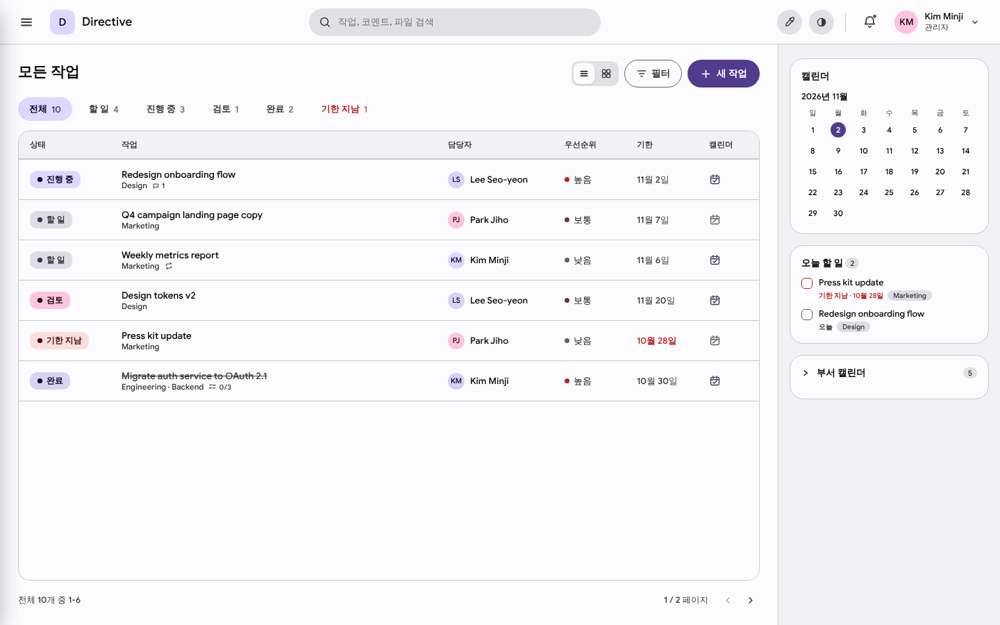
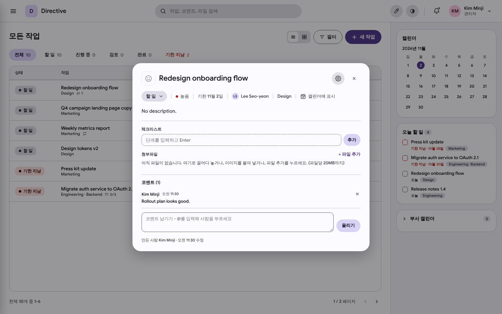
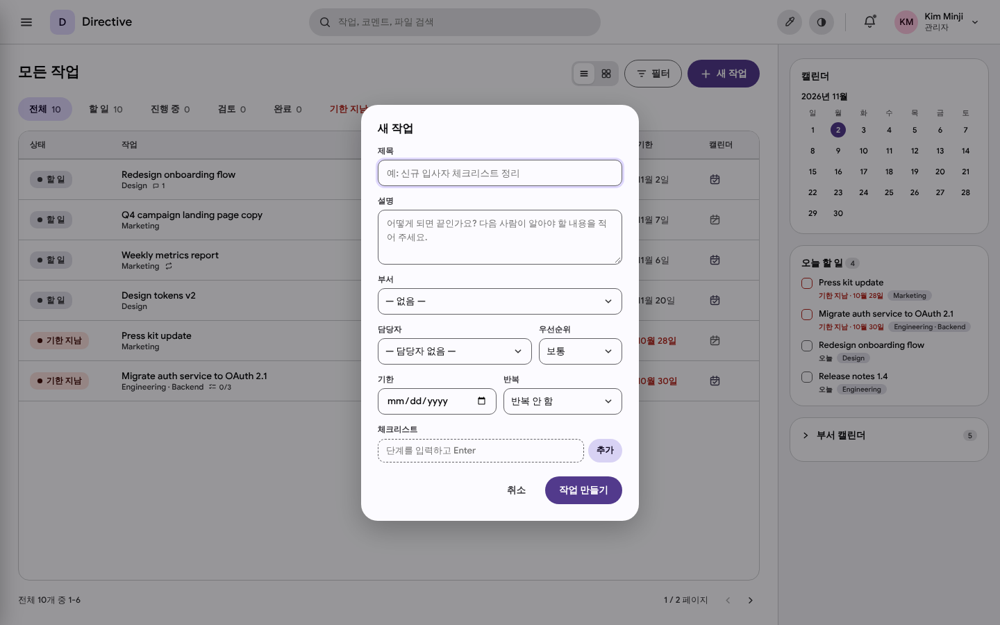
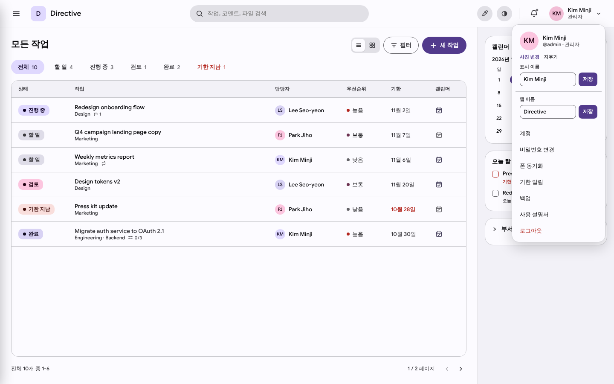
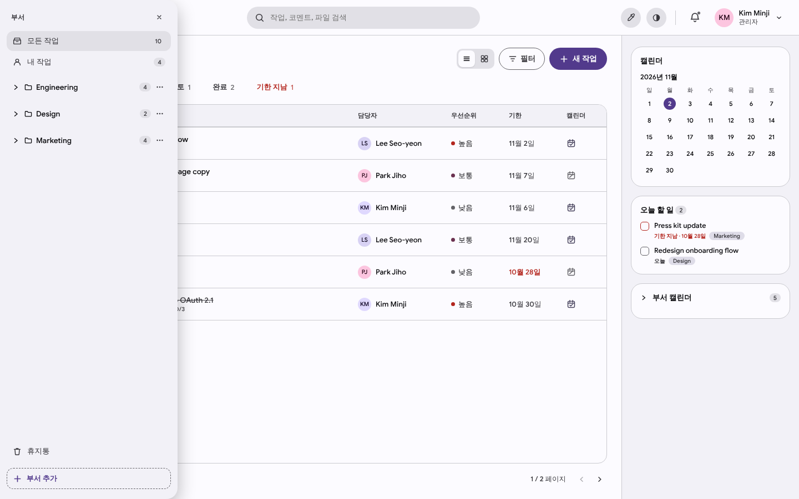
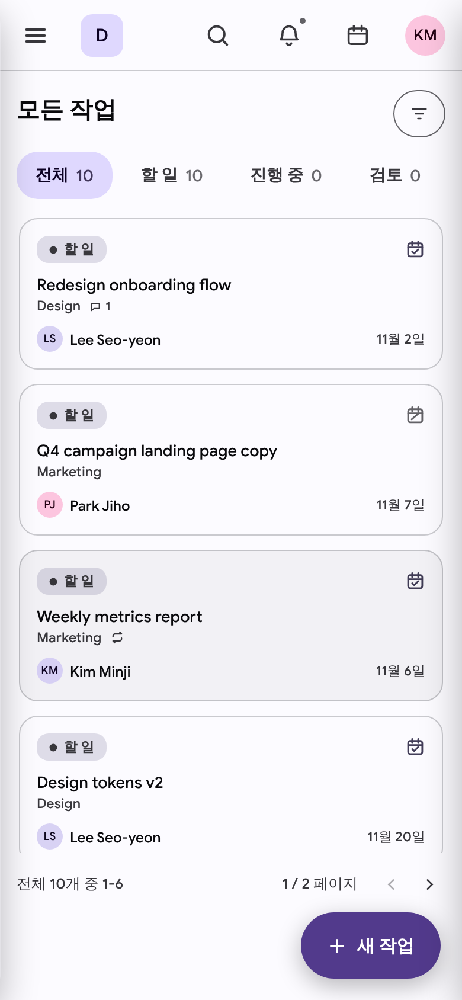

# Directive UI 개선 명세

> 대상: `server/static/` (`app.js`, `styles.css`, `index.html`, `generic.ttf`)
> 기준 화면: `docs/ui-spec/before/` (1440×900 데스크톱, 390×844 모바일, ko-KR, 샘플 데이터 10건)

---

## 0. 요약 — 왜 "조잡하고 식상해" 보이는가

| # | 원인 | 근거 |
|---|------|------|
| 1 | **Material 3 기본값이 그대로 정체성이 됨** | 기본 액센트가 M3 기준 보라색 `#6750A4`, 폰트는 Google Sans, 모든 색이 액센트에서 파생된 파스텔 tonal container. 누가 봐도 "Material 데모"처럼 보임. |
| 2 | **폰트가 망가져 있음** | `generic.ttf`는 *Google Sans Medium* 한 개 파일인데 `font-weight: 100 900`으로 선언 → 400도 Medium, 600/700은 브라우저가 가짜 볼드 합성. 한글 글리프가 없어 한글은 시스템 폰트로 대체되어 **한 줄 안에서 서체가 두 개 섞임** ("Kim Minji 관리자"). |
| 3 | **스케일이 없음** | 인라인 스타일에서 font-size 15종(9.5~21px, 11.5px만 50회), border-radius 18종, box-shadow 10종. 모든 값이 즉석에서 결정됨. |
| 4 | **색이 의미를 잃음** | 상태 색이 액센트의 tonal 팔레트에서 파생 → `진행 중`(primaryContainer)과 `완료`(secondaryContainer)가 둘 다 연보라, `검토`는 분홍. 아바타도 같은 3색을 씀. 결과적으로 화면 전체가 연보라 파스텔이고 색이 아무 정보도 전달하지 않음. |
| 5 | **레이아웃이 화면을 낭비함** | 1440px에서도 부서 사이드바가 햄버거 뒤에 숨어 있고, 목록은 6건 고정 페이지라 테이블의 60%가 빈 공간. 우측 300px은 할 일과 무관한 장식용 달력. |
| 6 | **장난감 같은 모션** | 모든 클릭 요소(테이블 행·카드 포함)가 눌릴 때 `scale(.92)`, 모달은 `.88`에서 오버슈트로 튀어나옴, 화면 전환마다 600ms 슬라이드. 업무 도구에서는 가볍고 느리게 느껴짐. |

**방향**: 액센트를 걷어내고 *중립 배경 + 강한 타이포그래피 + 의미 있는 상태 색 + 촘촘한 밀도*로 간다. 액센트는 "주 버튼 / 선택 상태 / 포커스" 세 곳에만 쓴다.

---

## 1. 발견된 결함 (즉시 수정)

| ID | 결함 | 위치 | 수정 |
|----|------|------|------|
| B1 | 닫힌 사이드 드로어의 그림자가 화면 왼쪽 가장자리에 약 24px 회색 그라데이션으로 항상 보임 (모든 스크린샷 좌측) | `styles.css` `.left-nav { box-shadow … transform: translateX(-100%) }` | 그림자를 `.open`, `.anim-open`, `.anim-close`에만 적용하거나 닫힌 상태에 `visibility: hidden` |
| B2 | 번들된 폰트는 *Google Sans Medium* (© Google)이며, 폰트 자체의 라이선스 문구가 "Google Sans is not one of them [open source fonts]. Please see google.com/fonts for alternatives." — 재배포 권한이 불분명 | `static/generic.ttf` name 테이블 | §2.2의 OFL 폰트로 교체 (디자인 이전에 법적 문제) |
| B3 | 한국어 화면에서 `No description.` 이 번역되지 않음 | `app.js` `taskDetailModal` (`'No description.'` 하드코딩, `T()` 누락) | `T('No description.')` + `i18n.js`에 항목 추가 |
| B4 | 새 작업 폼의 기한 입력이 네이티브 `type="date"` → 한국어 화면에 `mm/dd/yyyy` 노출, 옆의 커스텀 셀렉트와 모양 불일치 | `taskModal` `#newTaskDueInput` | §4.6 날짜 선택기 |
| B5 | 상세 보기의 "편집" 버튼이 톱니바퀴 아이콘 (설정 의미) | `taskDetailModal` `editFromDetail` | §4.5에서 인라인 편집으로 대체, 남길 경우 연필 아이콘 |

---

## 2. 디자인 토큰 (기반)

모든 값은 `styles.css`의 CSS 변수로 정의하고, `app.js`는 변수만 참조한다. `deriveColors()`의 Material 역할 21개(primary/secondary/tertiary/…Container)는 아래 시맨틱 토큰으로 대체.

### 2.1 색

**중립 (액센트와 무관, 보라 틴트 제거)**

| 토큰 | Light | Dark | 용도 |
|------|-------|------|------|
| `--bg-canvas` | `#F7F7F5` | `#0F0F11` | 앱 배경, 사이드바 |
| `--bg-surface` | `#FFFFFF` | `#17171A` | 메인 패널, 카드, 다이얼로그 |
| `--bg-subtle` | `#F1F1EF` | `#1E1E22` | 호버, 테이블 헤더, 입력 배경 |
| `--bg-muted` | `#E8E8E5` | `#26262B` | 눌림, 세그먼트 컨트롤 트랙 |
| `--border` | `#E4E4E0` | `#2A2A30` | 기본 구분선 |
| `--border-strong` | `#CFCFCA` | `#3A3A42` | 입력 테두리 |
| `--text` | `#1B1B1A` | `#EDEDEF` | 본문 |
| `--text-2` | `#5E5E59` | `#A1A1AA` | 보조 텍스트, 메타 |
| `--text-3` | `#8E8E88` | `#71717A` | 플레이스홀더, 비활성 |

**액센트 (사용자 선택, OKLCH 파생 로직은 유지하되 4개만 생성)**

| 토큰 | 파생 | 용도 |
|------|------|------|
| `--accent` | L 0.52 (dark 0.72) | 주 버튼, 선택 표시선, 링크 |
| `--accent-hover` | L −0.05 | 주 버튼 호버 |
| `--accent-subtle` | 같은 hue, C×0.25, L 0.96 (dark 0.25) | 선택된 행/사이드바 항목 배경 |
| `--accent-text` | 대비 4.5:1 보장 | accent 배경 위 글자 |

기본 액센트는 M3 보라(`#6750A4`) 대신 **`#3451D1` (잉크 블루)**. 프리셋 6종: `#3451D1` 잉크, `#0F766E` 파인, `#7C3AED` 바이올렛, `#C2410C` 테라코타, `#BE185D` 로즈, `#3F3F46` 그래파이트.

**상태 색 (고정, 액센트에 영향받지 않음)**

| 상태 | 색 (Light / Dark) | 아이콘 (§4.1) |
|------|------|------|
| 할 일 | `#8E8E88` / `#8B8B94` | ○ 빈 원 |
| 진행 중 | `#2F6FEB` / `#5B8DEF` | ◐ 반 채운 원 |
| 검토 | `#D97706` / `#F59E0B` | ◕ 3/4 원 |
| 완료 | `#16A34A` / `#22C55E` | ● 체크 원 |
| 기한 지남 | `#DC2626` / `#F87171` | (상태 아님 → 기한 텍스트에 적용) |

**우선순위**: 높음 `#EA580C`(주황, 기한 지남의 빨강과 구분), 보통 `--text-2`, 낮음 `--text-3`.

**아바타**: 이름 해시 → 8개 저채도 hue 중 하나 (액센트 파생 금지). 배경 L 0.90 / 글자 L 0.35.

### 2.2 타이포그래피

- **폰트**: [Pretendard Variable](https://github.com/orioncactus/pretendard) (SIL OFL 1.1) — 한글/라틴이 한 서체로 통일되고 가변 굵기 지원. 단일 바이너리 원칙을 지키기 위해 `static/`에 woff2로 동봉. 용량이 문제라면 Pretendard가 함께 배포하는 서브셋판(Std 등) 사용.
- 숫자 열(카운트, 날짜, 페이지): `font-variant-numeric: tabular-nums`.
- `-webkit-font-smoothing: antialiased`.

| 토큰 | size / line-height / weight | 용도 |
|------|------|------|
| `--t-display` | 24 / 32 / 650, `letter-spacing:-0.02em` | 페이지 제목 |
| `--t-title` | 18 / 26 / 600, `-0.01em` | 다이얼로그·패널 제목 |
| `--t-heading` | 15 / 22 / 600 | 섹션 제목 |
| `--t-body` | 14 / 20 / 400 | 본문, 입력값 |
| `--t-body-strong` | 14 / 20 / 500 | 작업 제목, 메뉴 항목 |
| `--t-small` | 13 / 18 / 400 | 메타 정보, 테이블 보조 |
| `--t-caption` | 12 / 16 / 500 | 라벨, 카운트, 컬럼 헤더 |

**규칙**: 12px 미만 금지 (현재 9.5/10/10.5/11/11.5px 전부 제거). 굵기는 400/500/600 세 단계만. 영문 대문자 라벨(`DEPARTMENTS`, `SORT BY`)은 일반 표기로.

### 2.3 간격·모서리·그림자

- **간격**: 4px 그리드 — `4 8 12 16 20 24 32 40`.
- **모서리**:

| 토큰 | 값 | 대상 |
|------|----|------|
| `--r-xs` | 4px | 체크박스, 칩, 태그, 키보드 힌트 |
| `--r-sm` | 6px | 버튼, 입력, 메뉴 항목, 행 호버 |
| `--r-md` | 10px | 카드, 팝오버, 메뉴 |
| `--r-lg` | 14px | 다이얼로그, 사이드 패널 |
| `--r-full` | 999px | 아바타, 상태 점만 |

버튼·탭·필터의 **알약(pill) 모양 폐기** — 현재 "식상함"의 가장 큰 시각적 원인.

- **그림자 (3단계)**:

| 토큰 | 값 | 대상 |
|------|----|------|
| `--e1` | `0 1px 2px rgb(0 0 0 / .05)` | 카드, 세그먼트 thumb |
| `--e2` | `0 0 0 1px var(--border), 0 8px 24px rgb(0 0 0 / .08)` | 메뉴, 팝오버, 드롭다운 |
| `--e3` | `0 0 0 1px var(--border), 0 24px 64px rgb(0 0 0 / .18)` | 다이얼로그, 오버레이 패널 |

다크 모드는 그림자 대신 `--border`와 한 단계 밝은 표면으로 구분.

### 2.4 모션

| 토큰 | 값 | 대상 |
|------|----|------|
| `--m-fast` | 100ms | 호버/눌림 색 변화 |
| `--m-base` | 160ms | 메뉴·팝오버 (opacity + translateY 4px) |
| `--m-slow` | 220ms | 다이얼로그, 사이드 패널 |
| `--ease` | `cubic-bezier(.2, 0, 0, 1)` | 공통 — **오버슈트 금지** |

- `.interactive:active { transform: scale(.92) }` 제거. 눌림은 배경색 변화로만. 아이콘 버튼에 한해 `scale(.96)` 허용.
- `.interactive:hover { filter: brightness(.96) }` 제거 → 요소별 `--bg-subtle` 배경.
- 목록 전환(`content-out`/`content-in`, 총 600ms 슬라이드) → 120ms opacity fade 또는 제거.
- `modalPopIn`(scale .88 + bounce) → opacity 0→1, scale .98→1, 220ms.
- `rowHighlight` 1350ms → 새 행에 `--accent-subtle` 배경 후 800ms fade.

---

## 3. 레이아웃

### 3.1 데스크톱 (≥1200px)

```
┌──────────────┬───────────────────────────────────────────┬──────────────────┐
│ ◼ Directive ▾│  Engineering / Backend                    │                  │
│              │  Backend 작업            [≡|▦] 필터 정렬 [+ 새 작업] │ (작업 선택 시)    │
│ ⌕ 검색  ⌘K   │  전체 10  할 일 4  진행 중 3  검토 1  완료 2  기한 지남 1 │  상세 패널       │
│              │  ───────────────────────────────────────  │  480px           │
│ ☐ 내 작업  4 │  ◐  Migrate auth service…  ☰1/3 💬1   Backend  (KM) Kim  오늘   ▮▮▮ │                  │
│ ◷ 오늘     2 │  ○  Q4 campaign landing…            Marketing (PJ) Park 11월 7일 ▮▮  │                  │
│ ▤ 모든 작업 10│  …                                        │                  │
│              │                                           │                  │
│ 부서       + │                                           │                  │
│ ▸ Engineering│                                           │                  │
│ ▸ Design     │                                           │                  │
│ ▸ Marketing  │                                           │                  │
│              │                                           │                  │
│ 🗑 휴지통     │                                           │                  │
│ ⚙ 설정       │  10개 중 1–10                              │                  │
└──────────────┴───────────────────────────────────────────┴──────────────────┘
   248px 고정         flex                                    작업 열면 슬라이드
```

- **상단 바(64px) 제거**, 그 역할을 사이드바 상단으로 이동해 세로 공간 64px 확보. 알림 벨과 아바타는 사이드바 하단 또는 메인 헤더 우측 상단.
  - 대안(변경 폭을 줄이려면): 상단 바 유지하되 높이 48px, 액센트·테마 버튼 제거.
- **사이드바 248px 상시 표시** (현재는 1440px에서도 햄버거 뒤에 숨어 있어 앱의 핵심 개념인 "부서"가 보이지 않음). `[` 키로 접기 → 56px 아이콘 레일.
- **우측 패널(달력·오늘 할 일·부서 캘린더) 기본 제거**:
  - 달력: 날짜에 작업 표시도 없고 클릭도 안 되는 장식 → 삭제. 필요하면 §5의 "캘린더 뷰"로.
  - 오늘 할 일 → 사이드바의 "오늘" 스마트 목록(카운트 포함).
  - 부서 캘린더 구독 링크 → 설정 > 캘린더 또는 부서 설정.
  - 그 자리는 **작업 상세 패널**이 사용 (§4.5).
- **목록 6건 고정 페이지 폐기**: `pageSize: 6` → 50건 + 하단 "더 보기"(또는 무한 스크롤). 1440×900에서 최소 14행이 한 화면에 보여야 함.

### 3.2 태블릿 (860–1199px)

사이드바는 56px 레일(아이콘+툴팁), 상세 패널은 메인 위에 덮이는 오버레이(`--e3` + 반투명 scrim).

### 3.3 모바일 (<860px)

- 상단 바: `[≡] 페이지 제목 ……… [⌕] [🔔] [아바타]` (52px). 현재 72px 너비 브랜드 타일 제거.
- 목록은 **카드 대신 2줄 행**(56px): 1행 상태 아이콘 + 제목, 2행 부서 · 담당자 · 기한. 카드 상단의 상태 칩 + 캘린더 아이콘 줄 삭제 → 화면당 표시 건수 4건 → 9건 이상.
- 페이지네이션 대신 무한 스크롤.
- FAB: 56×56 원형 `+` 아이콘만, 라벨 제거.
- 상세는 전체 화면 시트(아래에서 위로, 220ms).
- 드로어는 반투명 scrim(`rgb(0 0 0 / .32)`) 사용 — 현재 투명 scrim은 드로어가 열렸는지 인지하기 어려움.

---

## 4. 컴포넌트

### 4.1 상태 표시

- **현재**: 파스텔 알약 칩 `● 할 일` (132px 열 차지, 색 구분 불가).
- **변경**: 16px 상태 아이콘(§2.1 표의 ○ ◐ ◕ ●) + 필요 시 텍스트. 목록에서는 **아이콘만**, 제목 왼쪽에 배치.
- 아이콘 클릭 → 상태 변경 메뉴(키보드 `S`). 상세에서도 동일 컴포넌트.
- "기한 지남"은 저장 상태가 아니므로 칩으로 표시하지 않고 **기한 텍스트를 빨간색 + "3일 지남"**으로 표시. 상태 탭의 "기한 지남"은 유지.

### 4.2 작업 목록 행 (리스트 뷰)

| 열 | 너비 | 내용 |
|----|------|------|
| 상태 | 32px | 상태 아이콘 |
| 제목 | flex | 작업 아이콘(있을 때) + 제목(`--t-body-strong`) + 인라인 메타 배지(체크리스트 `1/3`, 댓글, 첨부, 반복) `--text-3` |
| 부서 | 140px | 중립 태그(`--bg-subtle`, `--r-xs`, `--t-caption`) |
| 담당자 | 160px | 아바타 20px + 이름 |
| 기한 | 96px | 상대 표기: `오늘`, `내일`, `금요일`, `11월 20일`, `3일 지남`(빨강) |
| 우선순위 | 40px | 신호 막대 아이콘 (▮▮▮ 높음/주황, ▮▮ 보통, ▮ 낮음) — 툴팁에 텍스트 |

- **"캘린더" 열 삭제** (88px를 거의 동일한 아이콘으로 채움). 캘린더 표시 여부는 상세 패널의 토글로만.
- 행 높이 44px, 구분선 `--border` 1px, 호버 `--bg-subtle`, **선택(상세 열림) 시 `--accent-subtle` + 좌측 2px `--accent`**.
- 컬럼 헤더 32px, `--t-caption`, `--text-3`, sticky. 클릭 시 정렬.
- 완료 작업: 취소선 대신 `--text-3` 색 (취소선은 가독성 저하).
- 테이블 외곽 테두리·라운드 박스 제거, 메인 영역 전체 폭 사용.

### 4.3 보드(그리드) 뷰

- 현재 그리드는 리스트와 같은 정보를 카드로 반복할 뿐 → **상태별 칸반 열**(할 일 / 진행 중 / 검토 / 완료)로 변경, 카드 드래그로 상태 변경.
- 카드: `--bg-surface`, `--border`, `--r-md`, `--e1`, 패딩 12px. 1행 제목, 2행 메타 배지, 3행 아바타 + 기한.
- 범위가 크면 1단계에서는 아이콘만 "보드"로 바꾸고 카드 디자인만 정리.

### 4.4 헤더·탭·툴바

- 경로: `Engineering / Backend` (`--t-small`, `--text-2`, 각 세그먼트 클릭 가능).
- 제목: `--t-display`.
- 상태 탭: 알약 → **밑줄 탭**. 활성 탭은 `--text` + 2px `--accent` 밑줄, 카운트는 `--text-3` tabular-nums. 0건 탭은 카운트를 흐리게.
- 툴바 버튼: 높이 32px, `--r-sm`.
  - 보기 전환: 세그먼트 컨트롤 (트랙 `--bg-muted`, thumb `--bg-surface` + `--e1`).
  - 필터: 고스트 버튼, 활성 시 `필터 · 2` (적용 개수 표시; 현재의 7px 점은 의미 불명확).
  - 정렬: 필터 팝오버에서 분리해 별도 버튼.
  - 새 작업: `--accent` 솔리드, 오른쪽에 키 힌트 `C`.

### 4.5 작업 상세 → 사이드 패널 + 인라인 편집

현재는 "읽기 모달" → 톱니바퀴 → "편집 모달" 2단계. 하나의 패널로 통합한다.

```
┌──────────────────────────────────────────┐
│ Engineering / Backend        🔗  ⋯   ✕   │
│                                          │
│ 😀 Migrate auth service to OAuth 2.1     │  ← 제목 인라인 편집 (--t-title)
│                                          │
│ 상태       ◐ 진행 중                      │
│ 담당자     (KM) Kim Minji                 │  ← 라벨 96px --text-2 / 값 클릭 시 팝오버
│ 우선순위   ▮▮▮ 높음                       │
│ 기한       10월 30일 · 3일 지남            │
│ 반복       없음                           │
│ 캘린더     [● 표시]                       │
│                                          │
│ 설명 추가…                                │  ← 비어 있으면 플레이스홀더 (B3)
│                                          │
│ 체크리스트  1/3 ━━━━━░░░░░░               │
│ ☑ Spec                                   │
│ ☐ Token store                            │
│ + 항목 추가                               │
│                                          │
│ 첨부파일                     + 추가        │
│                                          │
│ 활동                                      │
│ (KM) Kim Minji · 오전 11:30               │
│      Rollout plan looks good.            │
│ ·  Kim Minji가 상태를 진행 중으로 변경      │
│ ┌──────────────────────────────────────┐ │
│ │ 댓글 남기기… @로 멘션        ⌘↵ 보내기 │ │  ← 하단 고정, 자동 높이, resize 핸들 없음
│ └──────────────────────────────────────┘ │
└──────────────────────────────────────────┘
```

- 아이콘 슬롯: 아이콘이 없으면 숨기고 제목 호버 시 "아이콘 추가" 고스트 버튼 표시 (현재 점선 스마일리 박스 제거).
- 메타 정보를 `|`로 이어붙인 한 줄(현재) → 2열 속성 목록.
- 체크리스트 입력의 점선 테두리 제거 → `+ 항목 추가` 고스트 행.
- 첨부 안내 문구("여기로 끌어다 놓거나…")는 드래그 중일 때만 드롭존으로 표시.
- 댓글과 변경 이력을 하나의 "활동" 타임라인으로.
- `Esc` 닫기, `↑/↓`로 이전/다음 작업.

### 4.6 새 작업

- 모달 유지하되 **제목 우선** 구성:
  - 큰 제목 입력(`--t-title`, 테두리 없음) → 설명(자동 높이) → **속성 칩 한 줄** `[○ 할 일] [담당자] [우선순위] [기한] [부서] [반복]` → 하단 `[취소] [작업 만들기 ⌘↵]`.
  - 현재처럼 라벨+필드 7개를 세로로 쌓지 않음. 체크리스트는 생성 후 상세에서.
- 현재 선택된 부서를 기본값으로 (현재 "— 없음 —").
- **날짜 선택기**(B4): 팝오버에 빠른 선택 `오늘 / 내일 / 이번 주 금요일 / 다음 주 월요일 / 날짜 없음` + 미니 달력. 자연어 입력(`내일`, `11/20`) 지원은 선택.
- 셀렉트의 `— 없음 —` 표기 → `--text-3` 플레이스홀더 `담당자 없음`.

### 4.7 버튼·입력

| 종류 | 스펙 |
|------|------|
| Primary | 32px(대 40px), `--accent` 배경, `--accent-text`, `--r-sm`, `--t-body-strong` |
| Secondary | `--bg-surface` + `--border-strong` 1px |
| Ghost | 투명, 호버 `--bg-subtle` |
| Danger | 텍스트 `#DC2626`, 확정 단계에서만 솔리드 |
| Icon | 28/32px 정사각, `--r-sm` (현재 원형 36px 혼재) |
| Input | 36px, `--bg-surface`, `--border-strong`, `--r-sm`, 포커스 시 `--accent` 테두리 + 3px `--accent-subtle` 링 |

- 입력은 **라벨을 위에 항상 표시** (로그인 화면은 현재 플레이스홀더만 있어 입력 후 무슨 필드인지 사라짐).
- 버튼은 `<div>`가 아닌 `<button>`으로 (현재 `applyA11y`로 사후 보정 중).

### 4.8 알림 팝오버

- 너비 380px, `--e2`, `--r-md`.
- 탭: 밑줄 탭 `나에게 온 알림 / 활동`.
- 항목: 회색 박스 배경 제거 → `[아바타 24] **행위자** 동작 “작업 제목”  ·  5분 전`, 미읽음은 좌측 6px `--accent` 점.
- `오늘 / 어제 / 이번 주` 그룹 헤더.
- "활동" 탭은 **본인 행동 기본 제외** (현재 "내가 … 했습니다"가 목록을 채움). 토글로 포함 가능.
- 빈 상태: 아이콘 + "새 알림이 없습니다".

### 4.9 계정 메뉴 → 설정 화면 통합

현재 계정 드롭다운 안에 표시 이름·앱 이름 입력 폼과 저장 버튼이 들어 있고, 설정이 6개 모달(계정, 비밀번호, 폰 동기화, 기한 알림, 백업, 사용자)에 흩어져 있음. 액센트·테마 버튼은 매일 쓰지 않는데도 상단 바 최상단을 차지.

- **계정 메뉴** (간결하게): 프로필 헤더(아바타, 이름, @아이디 · 역할) / 테마 세그먼트 `라이트·다크·시스템` / 설정 / 사용 설명서 / 로그아웃.
- **설정** (전체 화면 또는 960px 다이얼로그, 좌측 섹션 내비):
  - 개인: 프로필(사진·표시 이름), 비밀번호, 알림(데스크톱 알림), 폰 동기화(앱 비밀번호), 외관(테마·액센트)
  - 관리자: 워크스페이스(앱 이름·아이콘), 사용자, 부서, 기한 알림, 백업, 캘린더 구독
- 상단 바의 스포이드(액센트) / 테마 버튼 제거.

### 4.10 사이드바

- 배경 `--bg-canvas`, 메인은 `--bg-surface` → 두 영역의 경계는 1px `--border`로만.
- 항목 32px, `--r-sm`, 아이콘 16px + `--t-body`. 선택 시 `--bg-muted` 배경 + `--text` 600 (액센트 배경 금지 — 현재 하위 부서 선택 시 연보라 알약).
- 카운트: 배경 알약 제거, 우측 정렬 `--t-caption` `--text-3` tabular-nums.
- 부서 트리: 폴더 아이콘 제거(모든 항목이 같은 아이콘이면 정보 없음) → 선택적으로 부서 색 점(§5). 하위 부서는 들여쓰기 + 1px 가이드 라인.
- "부서 추가" 큰 점선 버튼 → "부서" 섹션 헤더 오른쪽의 `+` 아이콘 버튼(관리자만).
- 부서 `⋯` 버튼은 호버 시에만 표시.

### 4.11 로그인

- 그림자 큰 카드 → 카드 없이 캔버스 위 360px 폼, 좌측 정렬.
- 상단 워드마크(아이콘 + "Directive"), 제목 `로그인` `--t-display`, 설명 `--t-small`.
- 라벨 있는 입력 2개, 전체 폭 Primary 버튼 40px, 하단 보조 링크.
- 최초 설정(관리자 생성) 화면은 제목을 `워크스페이스 만들기`로 구분.

### 4.12 빈 상태·로딩

- 빈 목록: 현재 "No tasks match." 한 줄 → 라인 아이콘 + 상황별 문구 + 행동 버튼
  - 필터 결과 없음 → `조건에 맞는 작업이 없습니다` + `[필터 지우기]`
  - 부서에 작업 없음 → `아직 작업이 없습니다` + `[새 작업]`
  - 검색 결과 없음 → `“…”에 대한 결과가 없습니다`
- 로딩: 행 모양 스켈레톤 3~5개 (`--bg-subtle`, 1.2s shimmer, reduced-motion 시 정지).

---

## 5. 선택 확장 (후순위)

| 항목 | 설명 |
|------|------|
| 커맨드 팔레트 `⌘K` | 작업·부서 이동, 새 작업, 상태 변경. 상단 검색창을 대체 |
| 키보드 단축키 | `C` 새 작업, `/` 검색, `J/K` 이동, `S` 상태, `A` 담당자, `D` 기한, `[` 사이드바 |
| 캘린더 뷰 | 리스트/보드 옆 세 번째 보기: 월간 그리드에 기한별 작업 표시 (우측 장식용 달력 대체) |
| 부서 색 | 부서마다 색 점 지정 → 사이드바·태그·캘린더에서 재사용 |
| 일괄 선택 | 행 체크박스 + 하단 액션 바(상태/담당자/삭제) |

---

## 6. 구현 지침

### 6.1 코드 구조

- 현재 `app.js`에 `style="…"` 인라인 스타일 486곳. 색·크기·모서리를 문자열로 이어붙이는 구조가 불일치의 근본 원인.
- **규칙**: 신규/수정 코드에서 색·폰트 크기·모서리·그림자를 인라인으로 쓰지 않는다. 동적 값(너비, 위치)만 인라인 허용.
- `styles.css`에 컴포넌트 클래스 추가: `.btn .btn-primary .btn-ghost .btn-icon`, `.field`, `.label`, `.tag`, `.status-icon`, `.avatar`, `.row`, `.menu .menu-item`, `.popover`, `.panel`, `.tabs .tab`, `.seg`.
- `app.js`에 작은 렌더 헬퍼: `button(opts)`, `statusIcon(status)`, `priorityIcon(p)`, `avatar(user, size)`, `tag(text)` — 같은 요소를 여러 곳에서 다른 값으로 그리는 현상 제거.
- `deriveColors()`는 액센트 4개만 반환하도록 축소, 나머지 토큰은 CSS `:root` / `[data-theme="dark"]`에 정적으로.
- 다크 모드는 `<html data-theme>` 속성으로 전환 (현재 렌더마다 21개 변수를 인라인 주입).

### 6.2 단계별 작업

| 단계 | 범위 | 효과 |
|------|------|------|
| **1. 기반** | B1~B3, 폰트 교체(§2.2), 토큰 정의(§2), 상태·우선순위 색 고정(§2.1), 모션 축소(§2.4), 알약→`--r-sm` | 레이아웃 변경 없이 인상이 가장 크게 바뀜 |
| **2. 레이아웃** | 사이드바 상시 표시(§3.1), 우측 패널 제거, 페이지 크기 50, 목록 행 재설계(§4.1–4.2), 밑줄 탭(§4.4), 상단 바 정리 | 정보 밀도·공간 활용 |
| **3. 컴포넌트** | 상세 사이드 패널 + 인라인 편집(§4.5), 새 작업 폼·날짜 선택기(§4.6, B4·B5), 알림(§4.8), 설정 통합(§4.9), 사이드바 세부(§4.10) | 사용 흐름 |
| **4. 다듬기** | 로그인(§4.11), 빈 상태·스켈레톤(§4.12), 모바일(§3.3), 보드 뷰(§4.3) | 완성도 |
| **5. 선택** | §5 | 생산성 |

#### 1단계 적용 결과

- **B1** 닫힌 드로어는 `visibility: hidden`, 그림자는 열려 있거나 움직이는 동안에만 → 왼쪽 회색 띠 제거 (모바일 우측 패널도 동일)
- **B2** `generic.ttf`(Google Sans) 삭제 → `static/fonts/pretendard-variable-1.3.9.woff2` + 라이선스 동봉. 서버가 `/fonts/*.woff2`에 `font/woff2`, `Cache-Control: immutable`(1년)을 붙임 (파일명에 버전 포함)
- **B3** `No description.` 번역
- **색**: `deriveColors()`가 액센트 4개 역할만 계산하고 중립색은 고정값. 기존 secondary/tertiary 역할은 성공(초록)·경고(주황)·중립으로 재배정. 상태(`STATUS_COLORS`)·우선순위(`PRIORITY_COLORS`)·아바타(`avatarColors()`, 이름 해시 8색)는 액센트와 무관. 기본 액센트 `#3451D1`, 프리셋 5종 + 직접 선택 슬롯
- **타이포**: 글자 크기를 12/13/14/15/18/24px로 정리(12px 미만 제거), 굵기 400/500/600. 예외: 모바일 입력 16px(iOS 확대 방지), 모바일 제목 20px, 이모지 글리프 17/20px
- **모서리·그림자**: `--r-xs/sm/md/lg`, `--e1/e2/e3` 토큰. 예외: 원형(50%), 알림 숫자 배지, FAB 16px, 진행 막대 2px
- **모션**: 눌림 시 축소(`scale .92`)와 밝기 필터 제거 → 반투명 상태 레이어(포인터 기기에서만 hover). 오버슈트 이징 전부 제거, 지속시간 100/160/220ms, 목록 전환은 90+140ms 페이드
- **목록 행**: 6개 셀이 각각 반응하던 구조 → subgrid로 묶은 한 행 = 한 컨트롤 (행 전체 hover, 탭 이동 1회)

#### 2단계 적용 결과

- **사이드바**: 1200px 이상에서 248px 고정 열(햄버거 숨김), 그 아래는 기존 드로어
- **우측 패널**: 상시 열 → 모든 화면에서 상단 바 캘린더 버튼으로 여는 "일정" 드로어 (달력·오늘 할 일·부서 캘린더 구독 유지). 스펙의 "오늘" 스마트 목록과 캘린더 뷰는 서버 변경이 필요해 후속으로 남김
- **상단 바**: 56px, 액센트·테마 버튼 → 계정 메뉴의 "화면 모양"으로 이동 (메뉴 폭 296px)
- **목록**: 페이지 크기 50, 한 페이지면 페이지 이동 버튼 숨김. 열 = 상태 아이콘 · 제목(+배지, 캘린더 표시 아이콘) · 부서 태그 · 담당자 · 상대 기한(오늘/내일/요일/N일 지남) · 우선순위 막대. 캘린더 열 삭제, 행 44px, 외곽 박스 제거
- **탭**: 알약 → 밑줄 탭
- 미적용(3단계로): 사이드바 세부 스타일(§4.10), 열 헤더 정렬, 보드 뷰

#### 3단계 적용 결과

- **작업 상세**: 가운데 모달 → 오른쪽 520px 패널(목록이 옆에 보임, 모바일은 전체 화면). 속성 목록(상태·담당자·우선순위·기한·반복·부서·캘린더)을 그 자리에서 바꾸면 바로 저장. 톱니 → 연필(제목·설명·반복 편집), 빈 설명은 "설명 추가…"
- **날짜 선택기**: 오늘/내일/이번 주 금요일/다음 주 월요일/기한 없음 + 월 달력. 새 작업 폼과 상세 패널에서 공용, 네이티브 `mm/dd/yyyy` 제거
- **알림**: 380px, 밑줄 탭, 회색 박스 → 미읽음 점 + 아바타, 오늘/어제/이전 묶음, 활동 탭은 내 행동 기본 제외(체크로 포함)
- **설정**: 계정 메뉴는 프로필·테마 전환·설정·사용 설명서·로그아웃만. 새 설정 창(프로필, 화면 모양, 비밀번호·동기화, 알림, [관리자] 워크스페이스, 계정, 기한 알림·백업). 계정·백업·폰 동기화 등 큰 도구는 기존 창을 설정 위에 띄움
- **사이드바**: 카운트 알약 제거, 폴더 아이콘 제거, 하위 부서 선택은 중립색, 부서 `⋯`는 hover 시만, "부서 추가"는 섹션 헤더의 `+`
- **번역 누락** 2곳(읽기 전용 안내) 수정
- 미적용: 새 작업 폼의 "제목 우선 + 속성 칩" 재구성, 활동 타임라인 통합, 체크리스트 고스트 행

#### 4단계 적용 결과

- **보드 뷰**: 그리드 → 상태별 칸반 4열(할 일/진행 중/검토/완료). 쓰기 권한이 있는 카드는 끌어서 다른 열에 놓으면 상태가 저장됨(드래그 중에는 다시 그리지 않아 드래그가 끊기지 않음). 카드는 제목·부서·배지·담당자·상대 기한·우선순위
- **모바일**: 카드 → 2줄 행(상태 아이콘·제목 / 부서·담당자·배지·기한, 우측 우선순위). 화면당 약 4건 → 9건. FAB는 56px 원형 `+`
- **로그인**: 그림자 카드 제거, 360px 좌측 정렬 폼, 제목(로그인/계정 만들기/워크스페이스 만들기), 입력 위 라벨, autocomplete 지정
- **빈 상태**: 검색 결과 없음(검색 지우기) / 필터·탭 결과 없음(필터 지우기) / 작업 없음(새 작업) 세 가지 + 아이콘. 첫 로딩은 스켈레톤 행
- 보기 전환 버튼에 "목록/보드" 라벨
- 후속 정리(완료): 모바일 상단 바에 페이지 제목, 빈 목록의 "0-0" 문구 숨김, 열 헤더 클릭 정렬(작업·기한·우선순위 — 서버가 지원하는 열만, 다시 누르면 기본 순서), 체크리스트 입력을 "+ 항목 추가" 행으로
- 새 작업 폼(완료): 큰 제목 입력 → 자동 높이 설명 → 속성 칩 한 줄(상태[편집 시]·담당자·우선순위·기한·반복·부서·캘린더[편집 시]), ⌘/Ctrl+Enter 저장. 전체·내 작업 화면에서 열면 부서 구성원은 자기 부서가 기본값
- 활동 타임라인(완료): 서버에 `GET /api/activity?task=<id>` 추가(테스트 포함). 상세 패널에서 댓글과 변경 이력(생성·수정·완료·다시 열기·첨부·휴지통)을 시간순 한 흐름으로, 댓글 입력칸은 패널 아래 고정·자동 높이·⌘/Ctrl+Enter로 올리기. 이력 항목은 "수정했습니다"까지만 — 무엇이 바뀌었는지는 서버가 기록하지 않음

#### 5단계(선택 확장) 적용 결과

- **⌘K / Ctrl+K 명령 메뉴**: 명령(새 작업, 부서 이동, 보기 전환, 검색, 일정, 테마, 설정, 휴지통, 사용 설명서) + 서버 작업 검색. ↑↓·Enter·Esc. 검색창 오른쪽에 ⌘K 표시
- **단축키**(입력칸 밖에서만): `C` 새 작업, `/` 검색, `J`/`K` 행 이동(Enter로 열기), `X` 선택, `1`/`2`/`3` 목록·보드·캘린더, `?` 명령 메뉴, `Esc` 선택 해제. 상세 패널이나 폼이 열려 있으면 이동·선택 키는 동작하지 않음
- **캘린더 보기**: 6주 월 그리드에 기한별 작업(부서 색 띠, 상태 아이콘), 이전·오늘·다음 달. 서버에 `dueFrom`/`dueTo` 조회 추가(테스트 포함). 한 달 최대 100건. 마지막 보기는 브라우저에 기억
- **부서 색**: 서버 `departments.color` 추가(관리자만, `#rrggbb` 검증·테스트 포함). 부서 설정에서 9색 중 선택, 하위 부서는 부모 색을 따름. 사이드바 점, 목록·보드 부서 태그, 모바일 행, 캘린더에 표시
- **여러 작업 선택**: 목록에서 상태 아이콘 자리에 마우스를 올리면 체크박스, 선택하면 하단 바(상태·우선순위·담당자 일괄 변경, 휴지통, 모두 선택, 해제). 작업마다 기존 API를 순서대로 호출
- 함께 고침: 사이드바 부서 행의 `class` 속성 중복(3단계에서 들어감)으로 `⋯`가 hover에 안 보이던 문제, 담당자 없음이 "Unassigned" 글자·아바타로 보이던 문제

### 6.3 완료 기준 (측정 가능)

- [ ] `app.js` + `styles.css`에서 사용하는 `font-size` 값이 7종 이하, 12px 미만 없음
- [ ] `border-radius` 값이 토큰 5종 이하
- [ ] `box-shadow` 값이 토큰 3종 이하
- [ ] 액센트를 프리셋 6종으로 바꿔도 상태·우선순위·아바타 색이 변하지 않음
- [ ] 한글·라틴이 같은 서체로 렌더링되고 400/500/600 굵기가 실제 다르게 보임
- [ ] 1440×900에서 목록이 페이지 이동 없이 14행 이상 표시
- [ ] 1440px에서 부서 사이드바가 기본으로 보임, 닫힌 드로어의 그림자 잔상 없음
- [ ] 텍스트 대비 WCAG AA(본문 4.5:1, 큰 글자·아이콘 3:1) — 라이트/다크 모두
- [ ] `prefers-reduced-motion`에서 모든 애니메이션 정지 (현행 유지)
- [ ] 한국어 화면에 미번역 영어 문구 없음

---

## 부록 A. 현재 화면 (Before)

| | |
|---|---|
|  목록 — 6건 페이지, 빈 공간, 연보라 단색 |  상세 — 톱니=편집, `No description.` |
|  새 작업 — 네이티브 `mm/dd/yyyy` |  계정 메뉴 — 드롭다운 속 입력 폼 |
|  1440px에서도 드로어로 숨은 부서 목록 |  모바일 — 화면당 카드 4건 |

## 부록 B. 측정치 (현재 `app.js` 인라인 스타일)

- `font-size`: 15종 — 11.5px ×50, 12.5px ×40, 13.5px ×39, 12px ×36, 13px ×33, 11px ×23, 10.5px ×11, 16px ×9, 10px ×5, 18px ×4, 14px ×4, 21px ×2, 17px ×2, 15px ×2, 9.5px ×1
- `border-radius`: 18종 — 10px ×47, 8px ×23, 20px ×17, 12px ×9, 24px ×7, 16px ×6, 6px ×5, 18/14px ×3, 5/22px ×2, 기타 7종 ×1
- `box-shadow`: 10종
- `style="` 속성: 486곳
